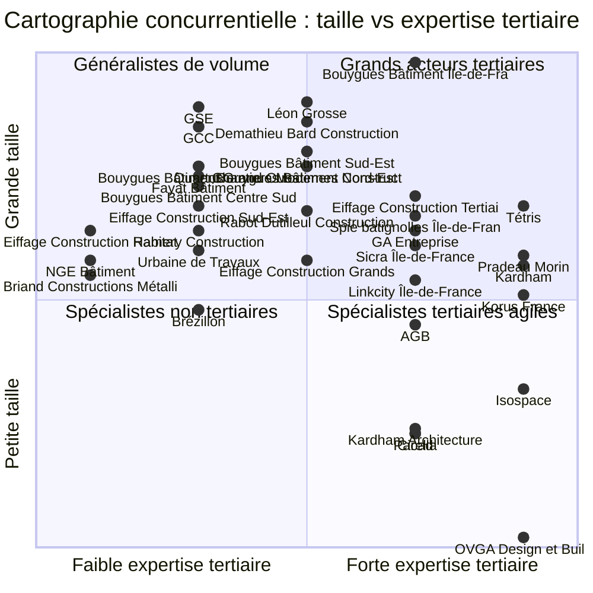

# Synthèse stratégique : les principaux contractants généraux en France (42 acteurs)

*Étude réalisée le 29/10/2026 à partir des comptes déposés (INPI, jeu « ratios_inpi_bce »), du registre national des entreprises et de sources publiques. Fiches détaillées dans [`fiches/`](fiches/) ; base comparative dans [`base-comparative.xlsx`](base-comparative.xlsx).*

## 1. Messages clés

1. **Un marché à trois étages.** Les filiales des majors (Bouygues, VINCI, Eiffage, Spie batignolles, Fayat) écrasent le marché en volume : à elle seule, Bouygues Bâtiment Île-de-France réalise 1,7 Md€. Les ETI indépendantes (Léon Grosse, Demathieu Bard, GCC) dépassent chacune 700 M€. Le contractant général « pur » est dominé par **GSE** (933 M€ consolidés). Le fit-out tertiaire reste concentré sur **Tétris** (236 M€), loin devant Korus (environ 155-168 M€ revendiqués au niveau du groupe, dont 67 M€ dans l'entité française DASA), Kardham (environ 100 M€) et une longue traîne de PME de moins de 50 M€.
2. **Une rentabilité structurellement mince.** La marge d'EBE médiane du panel ressort à **2,1 %** sur trois ans et 10 acteurs sur 42 ont un EBE moyen négatif. Les marges supérieures à 5 % relèvent de modèles particuliers : industrialisation (Briand, 13 %), petites structures spécialisées (Isospace 7 %, Cicad 6 %) ou honoraires (Turner & Townsend 15 %, Archimage 7 %).
3. **Le BFR est un critère clé.** Le modèle Bouygues fonctionne avec un BFR négatif (−24 jours de CA chez BB IDF) : les clients financent le chantier. À l'inverse, les filiales Eiffage, VINCI et Fayat portent plus de 100 jours de CA, adossées à la trésorerie de leur groupe. Côté fit-out, Tétris immobilise **103 jours de CA** : les spécialistes de l'aménagement financent une part importante des chantiers et négocient des échéanciers d'acomptes.
4. **Le CA publié surestime la valeur ajoutée.** Chez un CG, le CA inclut l'intégralité des travaux sous-traités. Tétris affiche ainsi une « marge brute » de 89 % du CA, alors que sa valeur ajoutée réelle est bien plus faible (sous-traitance classée en charges externes). La comparaison des marges doit se faire sur l'EBE et, idéalement, sur la marge sur travaux tirée des liasses.
5. **Peu d'acteurs maîtrisent vraiment l'aménagement tertiaire.** Une dizaine seulement combinent expertise des plateaux, capacité multi-sites et solidité financière. La dynamique concurrentielle est portée par les **offres intégrées des conseils internationaux** (JLL avec Tétris, CBRE avec Turner & Townsend) et par les **ensembliers** (Linkcity, GA), qui associent montage, conception, travaux et services.

## 2. Classement général (CA du dernier exercice publié)

Chaque ligne correspond à **une entité juridique**, sans addition entre filiales et groupes. Les comptes consolidés (type K) ne sont retenus que pour Léon Grosse, GSE et Quartus.

| # | Entreprise | Segment | Exercice | CA (M€) | Var. N-1 | TCAM | Marge EBE moy. 3 ans | Autonomie fin. | BFR (j) | Solidité | Score tertiaire | Note |
|--:|---|---|---|--:|--:|--:|--:|--:|--:|:-:|:-:|:-:|
| 1 | [Bouygues Bâtiment Île-de-France](fiches/01-bouygues-batiment-ile-de-france.md) | Majors / EG | 2025-12 | 1 718,7 | 6,5 % | 3,9 % | 2,5 % | 7,1 % | -24 | 3/5 | 4.2 | **3.0** |
| 2 | [Léon Grosse](fiches/02-leon-grosse.md) *(conso.)* | Majors / EG | 2025-12 | 981,2 | 8,1 % | 11,7 % | 2,0 % | 16,9 % | 15 | 3/5 | 3.4 | **3.0** |
| 3 | [GSE](fiches/03-gse.md) *(conso.)* | CG clé en main | 2026-03 | 932,9 | 15,5 % | 2,3 % | 4,4 % | 25,4 % | 25 | 5/5 | 3.8 | **4.3** |
| 4 | [Demathieu Bard Construction](fiches/04-demathieu-bard-construction.md) | Majors / EG | 2025-12 | 784,8 | 4,6 % | 5,6 % | 2,7 % | 7,2 % | 2 | 3/5 | 3.4 | **3.0** |
| 5 | [GCC](fiches/05-gcc.md) | Majors / EG | 2025-09 | 718,1 | -6,8 % | 7,0 % | 2,8 % | 6,6 % | 162 | 2/5 | 2.6 | **2.0** |
| 6 | [Bouygues Bâtiment Sud-Est](fiches/06-bouygues-batiment-sud-est.md) | Majors / EG | 2025-12 | 499,4 | 22,9 % | 16,0 % | 5,2 % | 15,7 % | 21 | 4/5 | 3.4 | **3.0** |
| 7 | [Quartus](fiches/07-quartus.md) *(conso.)* | CG clé en main | 2024-12 | 419,7 | -22,0 % | -6,7 % | 0,0 % | 14,9 % | 324 | 1/5 | 2.2 | **1.0** |
| 8 | [Bouygues Bâtiment Grand Ouest](fiches/08-bouygues-batiment-grand-ouest.md) | Majors / EG | 2025-12 | 414,4 | 0,1 % | -3,2 % | 3,6 % | 19,8 % | -15 | 4/5 | 3.0 | **2.7** |
| 9 | [Bouygues Bâtiment Nord-Est](fiches/09-bouygues-batiment-nord-est.md) | Majors / EG | 2025-12 | 411,9 | -13,2 % | 4,3 % | 3,6 % | 17,3 % | -44 | 4/5 | 3.2 | **2.7** |
| 10 | [Chantiers Modernes Construction (VINCI)](fiches/10-chantiers-modernes-construction.md) | Majors / EG | 2024-12 | 401,0 | 1,7 % | 12,6 % | 8,0 % | 3,3 % | 5 | 3/5 | 3.2 | **2.3** |
| 11 | [Fayat Bâtiment](fiches/11-fayat-batiment.md) | Majors / EG | 2025-09 | 346,8 | -0,6 % | 6,3 % | 0,1 % | 6,7 % | 111 | 1/5 | 2.6 | **1.7** |
| 12 | [Bouygues Bâtiment Centre Sud-Ouest](fiches/12-bouygues-batiment-centre-sud-ouest.md) | Majors / EG | 2025-12 | 303,8 | 0,0 % | 4,4 % | 2,6 % | 14,0 % | -17 | 3/5 | 2.8 | **2.3** |
| 13 | [Eiffage Construction Tertiaire](fiches/13-eiffage-construction-tertiaire.md) | Majors / EG | 2025-12 | 267,7 | 27,0 % | 6,8 % | 3,2 % | 3,1 % | 132 | 2/5 | 3.6 | **2.7** |
| 14 | [Tétris (JLL)](fiches/14-tetris.md) | Fit-out tertiaire | 2025-12 | 235,7 | 4,8 % | 5,9 % | 2,8 % | 18,6 % | 103 | 4/5 | 4.4 | **4.3** |
| 15 | [Eiffage Construction Sud-Est](fiches/15-eiffage-construction-sud-est.md) | Majors / EG | 2025-12 | 227,2 | -9,1 % | 1,9 % | 2,1 % | 4,3 % | 87 | 2/5 | 2.6 | **2.0** |
| 16 | [Rabot Dutilleul Construction](fiches/16-rabot-dutilleul-construction.md) | Majors / EG | 2024-12 | 224,4 | 7,4 % | 4,4 % | -0,1 % | 8,8 % | 49 | 1/5 | 2.4 | **1.7** |
| 17 | [Spie batignolles Île-de-France](fiches/17-spie-batignolles-ile-de-france.md) | Majors / EG | 2025-12 | 204,4 | 0,0 % | 10,4 % | 1,9 % | 7,9 % | -5 | 2/5 | 3.4 | **2.7** |
| 18 | [Eiffage Construction Habitat](fiches/18-eiffage-construction-habitat.md) | Majors / EG | 2025-12 | 165,5 | 48,6 % | -3,8 % | 3,4 % | 3,1 % | 164 | 2/5 | 2.2 | **1.7** |
| 19 | [GA Entreprise (GA Smart Building)](fiches/19-ga-smart-building.md) | CG clé en main | 2024-12 | 163,2 | -28,4 % | -1,5 % | 1,0 % | 2,8 % | 162 | 1/5 | 3.4 | **2.7** |
| 20 | [Ramery Construction](fiches/20-ramery-construction.md) | Majors / EG | 2024-12 | 163,1 | -9,9 % | 4,5 % | -0,7 % | 20,2 % | 71 | 2/5 | 2.4 | **1.7** |
| 21 | [Sicra Île-de-France (VINCI)](fiches/21-sicra-ile-de-france.md) | Majors / EG | 2024-12 | 132,1 | 7,7 % | -7,2 % | -3,4 % | 1,9 % | 150 | 1/5 | 2.8 | **1.7** |
| 22 | [Urbaine de Travaux (Fayat)](fiches/22-urbaine-de-travaux.md) | Majors / EG | 2025-09 | 123,2 | -14,3 % | -5,7 % | 0,7 % | 12,4 % | 70 | 2/5 | 2.2 | **1.7** |
| 23 | [Pradeau Morin (Eiffage)](fiches/23-pradeau-morin.md) | Majors / EG | 2025-12 | 115,1 | 36,2 % | 4,2 % | -0,1 % | 4,2 % | 203 | 1/5 | 3.4 | **2.7** |
| 24 | [Eiffage Construction Grands Projets](fiches/24-eiffage-construction-grands-projets.md) | Majors / EG | 2025-12 | 111,1 | -19,7 % | -12,3 % | -2,2 % | 1,4 % | 188 | 1/5 | 3.0 | **1.7** |
| 25 | [NGE Bâtiment](fiches/25-nge-batiment.md) | Majors / EG | 2025-12 | 110,4 | -5,8 % | -4,4 % | -14,0 % | 0,8 % | 139 | 1/5 | 1.6 | **1.3** |
| 26 | [Kardham](fiches/26-kardham.md) | Fit-out tertiaire | 2022-12 | 101,7 | 26,8 % | 30,5 % | 2,6 % | 7,3 % | 109 | 3/5 | 3.8 | **3.7** |
| 27 | [Briand Constructions Métalliques](fiches/27-briand.md) | CG clé en main | 2025-09 | 90,2 | -38,6 % | 8,4 % | 13,2 % | 14,9 % | 127 | 4/5 | 3.0 | **3.3** |
| 28 | [Linkcity Île-de-France](fiches/28-linkcity-ile-de-france.md) | CG clé en main | 2025-12 | 84,7 | -2,0 % | -19,8 % | -6,1 % | 27,5 % | 151 | 2/5 | 3.8 | **2.7** |
| 29 | [Korus France (DASA)](fiches/29-korus.md) | Fit-out tertiaire | 2025-12 | 67,3 | -11,9 % | 4,4 % | 1,0 % | 5,5 % | 95 | 1/5 | 3.8 | **3.0** |
| 30 | [Brézillon (Bouygues)](fiches/30-brezillon.md) | Majors / EG | 2025-12 | 53,1 | 23,5 % | -30,5 % | 1,8 % | 51,3 % | 86 | 4/5 | 2.4 | **2.0** |
| 31 | [AGB – Agencement Général du Bâtiment](fiches/31-agb-agencement-general-du-batiment.md) | Fit-out tertiaire | 2024-03 | 44,7 | -4,4 % | 4,2 % | 1,4 % | 15,6 % | 98 | 3/5 | 2.6 | **2.7** |
| 32 | [Spie batignolles Présance IDF](fiches/32-spie-batignolles-presance.md) | Majors / EG | 2024-12 | 41,3 | 11,3 % | 5,6 % | 2,3 % | 5,0 % | 36 | 2/5 | 3.2 | **2.7** |
| 33 | [Legendre Construction (entité ingénierie/holding)](fiches/33-legendre.md) | Majors / EG | 2025-12 | 37,1 | 30,6 % | 29,1 % | -8,6 % | 56,1 % | 60 | 2/5 | 3.0 | **2.3** |
| 34 | [Ossabois](fiches/34-ossabois.md) | CG clé en main | 2025-12 | 34,8 | -11,8 % | -2,2 % | -2,5 % | 4,2 % | 81 | 1/5 | 1.6 | **1.3** |
| 35 | [Isospace](fiches/35-isospace.md) | Fit-out tertiaire | 2024-12 | 18,3 | 8,6 % | 12,6 % | 7,3 % | 25,9 % | 81 | 5/5 | 3.4 | **4.0** |
| 36 | [Elcimaï Réalisations](fiches/36-elcimai-realisations.md) | CG clé en main | 2025-12 | 17,7 | -50,4 % | 1,1 % | 10,6 % | 14,3 % | 151 | 4/5 | 2.4 | **2.7** |
| 37 | [Turner & Townsend (France)](fiches/37-turner-townsend-france.md) | AMO | 2024-04 | 14,5 | 39,2 % | 36,9 % | 15,3 % | 30,1 % | 46 | 5/5 | 3.4 | **3.0** |
| 38 | [Kardham Architecture](fiches/38-kardham-architecture.md) | Fit-out tertiaire | 2024-12 | 10,8 | -3,8 % | 5,2 % | 0,9 % | 5,8 % | 127 | 1/5 | 3.0 | **1.7** |
| 39 | [Parella](fiches/39-parella.md) | Fit-out tertiaire | 2025-12 | 10,1 | n.d. | n.d. | -11,2 % | -3,6 % | 190 | 1/5 | 2.6 | **1.7** |
| 40 | [Cicad](fiches/40-cicad.md) | Fit-out tertiaire | 2025-12 | 9,5 | -6,1 % | 5,3 % | 5,6 % | 19,6 % | 108 | 5/5 | 2.8 | **3.0** |
| 41 | [Archimage](fiches/41-archimage.md) | AMO | 2025-06 | 3,2 | -12,4 % | -2,0 % | 6,9 % | 26,5 % | 373 | 5/5 | 3.0 | **2.7** |
| 42 | [OVGA Design & Build](fiches/42-ovga-design-build.md) | Fit-out tertiaire | n.d. | n.d. | n.d. | n.d. | n.d. | n.d. | n.d. | n.d. | 3.2 | **3.0** |

*Note globale = moyenne de l'attractivité (jugée), de la solidité (calculée) et du potentiel (jugé). Le score tertiaire est la moyenne des 5 critères de la grille de lecture tertiaire : expertise tertiaire, accès aux donneurs d'ordre, capacité de réalisation, modèle de marge et capacité financière.*

## 3. Lecture par segment

| Segment | Nb | CA cumulé (M€) | Marge EBE médiane | BFR médian (j) | Autonomie fin. médiane |
|---|--:|--:|--:|--:|--:|
| Majors / entreprises générales | 24 | 8 556 | 2,0 % | 65 | 7,2 % |
| Contractants généraux clé en main / ensembliers | 7 | 1 743 | 1,0 % | 151 | 14,9 % |
| Fit-out et design & build tertiaire | 9 | 498 | 2,0 % | 105 | 11,5 % |
| AMO / project management | 2 | 18 | 11,1 % | 210 | 28,3 % |

- **Majors et EG.** Leur force tient au volume, à l'ingénierie et à la trésorerie du groupe. Les filiales Bouygues sont les plus homogènes (BFR négatif, EBE de 2 à 8 %). Les filiales Eiffage et VINCI ont des fonds propres très faibles (1 à 5 % du bilan) et vivent de la garantie implicite du groupe. Les indépendants (Léon Grosse, Demathieu Bard, GCC) croissent vite (TCAM de 6 à 12 %) mais avec des marges de 2 à 3 % ; la dégradation de GCC en 2025 (EBE ramené de 34 à 4 M€, BFR de 162 jours) mérite d'être suivie.
- **CG clé en main.** GSE est la référence du modèle (conception intégrée, 100 % des travaux sous-traités, BFR social négatif, adossement à GOLDBECK). GA et Briand illustrent l'intégration industrielle (usines béton, métal, bois), qui produit soit des marges élevées (Briand), soit un BFR et un levier lourds (GA). Les ensembliers (Linkcity, Quartus) souffrent de la crise de la promotion.
- **Fit-out tertiaire.** C'est un marché fragmenté : Tétris détient une position de leader incontestée, Kardham et Korus jouent l'intégration du conseil au mobilier (Korus y ajoute la maintenance de réseaux multi-sites, mais avec des marges quasi nulles dans son entité française), les architectes-contractants comme OVGA se placent sur la transformation d'immeubles, et les PME agiles (Isospace, Cicad) sont rentables mais limitées en capacité. Les acteurs hybrides conseil-CG (Parella) sont fragiles financièrement.
- **AMO.** Les marges sont élevées et le capital engagé faible, mais ces acteurs ne réalisent pas. Ce sont des **prescripteurs** à cultiver plutôt que des partenaires travaux.

## 4. Rentabilité : leaders et acteurs en difficulté

**Top 10 de la marge d'EBE (moyenne sur 3 ans)**

| Entreprise | Marge EBE moy. 3 ans | CA (M€) |
|---|--:|--:|
| [Turner & Townsend (France)](fiches/37-turner-townsend-france.md) | 15,3 % | 14,5 |
| [Briand Constructions Métalliques](fiches/27-briand.md) | 13,2 % | 90,2 |
| [Elcimaï Réalisations](fiches/36-elcimai-realisations.md) | 10,6 % | 17,7 |
| [Chantiers Modernes Construction (VINCI)](fiches/10-chantiers-modernes-construction.md) | 8,0 % | 401,0 |
| [Isospace](fiches/35-isospace.md) | 7,3 % | 18,3 |
| [Archimage](fiches/41-archimage.md) | 6,9 % | 3,2 |
| [Cicad](fiches/40-cicad.md) | 5,6 % | 9,5 |
| [Bouygues Bâtiment Sud-Est](fiches/06-bouygues-batiment-sud-est.md) | 5,2 % | 499,4 |
| [GSE](fiches/03-gse.md) | 4,4 % | 932,9 |
| [Bouygues Bâtiment Grand Ouest](fiches/08-bouygues-batiment-grand-ouest.md) | 3,6 % | 414,4 |

**Acteurs à EBE moyen négatif (vigilance contrepartie)**

| Entreprise | Marge EBE moy. 3 ans | Autonomie fin. |
|---|--:|--:|
| [NGE Bâtiment](fiches/25-nge-batiment.md) | -14,0 % | 0,8 % |
| [Parella](fiches/39-parella.md) | -11,2 % | -3,6 % |
| [Legendre Construction (entité ingénierie/holding)](fiches/33-legendre.md) | -8,6 % | 56,1 % |
| [Linkcity Île-de-France](fiches/28-linkcity-ile-de-france.md) | -6,1 % | 27,5 % |
| [Sicra Île-de-France (VINCI)](fiches/21-sicra-ile-de-france.md) | -3,4 % | 1,9 % |
| [Ossabois](fiches/34-ossabois.md) | -2,5 % | 4,2 % |
| [Eiffage Construction Grands Projets](fiches/24-eiffage-construction-grands-projets.md) | -2,2 % | 1,4 % |
| [Ramery Construction](fiches/20-ramery-construction.md) | -0,7 % | 20,2 % |
| [Rabot Dutilleul Construction](fiches/16-rabot-dutilleul-construction.md) | -0,1 % | 8,8 % |
| [Pradeau Morin (Eiffage)](fiches/23-pradeau-morin.md) | -0,1 % | 4,2 % |

*Les marges de Chantiers Modernes (EBE 2024 exceptionnel) et d'Elcimaï Réalisations (CA très volatil) sont à confirmer dans les liasses.*

## 5. Cartographie concurrentielle

*Lecture : en haut à droite, les grands acteurs tertiaires (Bouygues Bâtiment IDF, Eiffage Construction Tertiaire, Tétris) ; en bas à droite, les spécialistes tertiaires agiles (Isospace, Cicad, Pradeau Morin, Spie batignolles Présance) ; en haut à gauche, les généralistes de volume orientés logement, industrie ou logistique.*

## 6. Analyse des modèles économiques

| Modèle | Exemples | Source de marge | Portage du risque | BFR | Pertinence pour l'aménagement de bureaux |
|---|---|---|---|---|---|
| **Entreprise générale de major** | Bouygues, Eiffage, VINCI | Marge sur travaux, production propre de gros œuvre | Prix-délai forfaitaire | Négatif (Bouygues) à très positif (Eiffage, VINCI) | Faible : seuils trop élevés pour un plateau seul |
| **EG indépendante** | Léon Grosse, Demathieu Bard, GCC | Marge sur travaux | Forfait | Proche de zéro à élevé | Moyen : restructuration d'immeubles entiers |
| **Contractant général pur** | GSE, Elcimaï Réalisations | Marge sur achats et ingénierie, 100 % sous-traité | Forfait global + conception | Négatif à modéré | Faible : orienté logistique et industrie |
| **CG industrialisé** | GA, Briand, Ossabois | Marge industrielle + CG | Forfait + risque usine | Élevé | Moyen : modules et bureaux hors-site |
| **Fit-out design & build** | Tétris, Korus, Kardham, Isospace, OVGA | Honoraires de design + marge sur travaux (et mobilier) | Forfait prix-délai sur plateau | Environ 100 jours | **Forte : cœur de métier** |
| **Agenceur / second œuvre** | AGB, Spie batignolles Présance | Marge de production | Lots ou TCE | Modéré | **Fort : maîtrise du coût au m²** |
| **Ensemblier / promoteur** | Linkcity, Quartus | Marge de promotion | Risque foncier et commercial | Très élevé | Moyenne : reconversion d'actifs |
| **AMO / PM** | Turner & Townsend, Archimage, Parella | Honoraires | Faible (obligation de moyens) | Élevé mais peu de capital | Prescription et pilotage |

**Points de méthode.** (1) La marge sur travaux d'un fit-out se situe en pratique entre 8 et 15 % du montant des travaux (ordre de grandeur de marché, à valider par liasse) et l'EBE publié n'en conserve que 3 à 7 % après frais de structure. (2) Les honoraires de conception et de pilotage sont rarement isolés dans les comptes : il faut les demander dans les propositions (décomposition « études / travaux / mobilier / honoraires »). (3) Pour mémoire, les ordres de grandeur de prix retenus sur ce site sont de 150 à 400 €/m² HT pour un rafraîchissement, 500 à 900 €/m² pour un aménagement standard et plus de 1 000 €/m² pour un projet haut de gamme.

## 7. Lecture tertiaire : quels acteurs pour quels projets

**Classement selon la grille de lecture tertiaire (top 15)**

| Entreprise | Expertise tertiaire | Score tertiaire | Rôle dans l'écosystème |
|---|:-:|:-:|---|
| [Tétris (JLL)](fiches/14-tetris.md) | 5/5 | 4.4 | Leader du fit-out, intégré à un conseil immobilier international (JLL) |
| [Bouygues Bâtiment Île-de-France](fiches/01-bouygues-batiment-ile-de-france.md) | 4/5 | 4.2 | Réalisateur d'immeubles entiers : neuf et restructuration lourde |
| [Kardham](fiches/26-kardham.md) | 5/5 | 3.8 | Intégrateur conseil, conception, aménagement et mobilier multi-sites |
| [Korus France (DASA)](fiches/29-korus.md) | 5/5 | 3.8 | Intégrateur multi-sites : aménagement, mobilier et maintenance de réseaux |
| [Linkcity Île-de-France](fiches/28-linkcity-ile-de-france.md) | 4/5 | 3.8 | Développeur-ensemblier : reconversion d'actifs tertiaires |
| [GSE](fiches/03-gse.md) | 2/5 | 3.8 | Modèle de référence du contractant général pur (logistique, industrie) |
| [Eiffage Construction Tertiaire](fiches/13-eiffage-construction-tertiaire.md) | 4/5 | 3.6 | Réalisateur de restructurations d'immeubles tertiaires |
| [Pradeau Morin (Eiffage)](fiches/23-pradeau-morin.md) | 5/5 | 3.4 | Spécialiste de la restructuration d'immeubles parisiens anciens |
| [Isospace](fiches/35-isospace.md) | 5/5 | 3.4 | Spécialiste agile des plateaux de 150 à 2 000 m² |
| [Spie batignolles Île-de-France](fiches/17-spie-batignolles-ile-de-france.md) | 4/5 | 3.4 | Entreprise générale de volume (neuf, réhabilitation) |
| [GA Entreprise (GA Smart Building)](fiches/19-ga-smart-building.md) | 4/5 | 3.4 | Ensemblier intégré : promotion, produit industrialisé et réalisation |
| [Turner & Townsend (France)](fiches/37-turner-townsend-france.md) | 4/5 | 3.4 | Prescripteur (AMO / project management) |
| [Léon Grosse](fiches/02-leon-grosse.md) | 3/5 | 3.4 | Réalisateur d'immeubles entiers : neuf et restructuration |
| [Demathieu Bard Construction](fiches/04-demathieu-bard-construction.md) | 3/5 | 3.4 | Entreprise générale de volume (neuf, réhabilitation) |
| [Bouygues Bâtiment Sud-Est](fiches/06-bouygues-batiment-sud-est.md) | 3/5 | 3.4 | Entreprise générale de volume (neuf, réhabilitation) |

### Typologie des projets et acteurs adaptés

| Type de projet | Acteurs les mieux positionnés | Pourquoi |
|---|---|---|
| Déploiement multi-sites ou grand siège (> 5 000 m²) | **Tétris**, **Kardham**, **Korus** | Couverture nationale, conception intégrée et capacité à mener plusieurs chantiers en parallèle ; Tétris est le plus solide financièrement (autonomie de 19 %, aucune dette) ; Korus est le seul à intégrer aussi la maintenance des sites. |
| Plateau de 150 à 2 000 m² en Île-de-France | **Isospace**, **Cicad** | PME rentables (marge d'EBE moyenne de 7 % et 6 %), sans endettement significatif ; capacité limitée à quelques chantiers importants en parallèle. |
| Achat de second œuvre en direct ou en contrat-cadre | **AGB**, **Spie batignolles Présance** | Production en propre ou TCE de petits travaux, ce qui supprime un étage de marge de CG ; Présance est adapté au site occupé. |
| Restructuration lourde d'immeuble parisien | **Pradeau Morin**, **OVGA** (conception + CG), **Eiffage Construction Tertiaire**, **Bouygues Bâtiment IDF** | Ingénierie de réhabilitation et capacité à porter des immeubles entiers ; Pradeau Morin reste fragile financièrement et OVGA ne publie pas ses comptes. |
| Reconversion d'actif obsolète | **Linkcity IDF**, **GA Smart Building** | Montage et conception-réalisation intégrés ; tous deux exposés au cycle de l'investissement. |
| Pilotage et contrôle des coûts | **Turner & Townsend**, **Archimage**, **Parella** | AMO et project management, sans portage du risque travaux. |

### Dynamiques concurrentielles

- **Intégration conseil + travaux.** JLL (avec Tétris) et CBRE (avec Turner & Townsend) assemblent transaction, conseil, project management et réalisation. Cette offre unique capte une part croissante des projets des grands utilisateurs.
- **Ensembliers.** Linkcity et GA intègrent le montage, la conception et le produit industrialisé, ce qui leur permet de proposer des immeubles ou plateaux « prêts à l'emploi ».
- **Pression sur les PME.** Le marché du fit-out reste fragmenté. Les PME rentables (Isospace, Cicad) sont des cibles naturelles de croissance externe, tandis que les hybrides conseil-CG fragiles (Parella) sont exposés.

**Points de contrôle pour un maître d'ouvrage avant contractualisation** (à partir des risques observés) : attestations décennale et RC, garantie de paiement des sous-traitants (loi de 1975), part de travaux sous-traités, BFR et délais fournisseurs (au-delà de 120 jours, signal de tension), retenue de garantie de 5 % et caution de restitution d'acompte.

## 8. Limites de l'étude et prochaines étapes

- **Panel raisonné.** Aucun classement officiel des « contractants généraux » n'existe : le périmètre retenu mélange CG, EG, fit-out et AMO, conformément à la méthode. Les grands groupes sont représentés par leurs filiales opérationnelles, pour éviter les doubles comptes. Certains acteurs du fit-out francilien de taille moyenne n'ont pu être identifiés avec certitude au registre et restent à ajouter (Majorelle, BW, Genesis Group).
- **Données financières.** Elles proviennent des comptes déposés (ratios normalisés INPI/BCE). Les comptes confidentiels (Kardham après 2022, OVGA après 2016) et les comptes consolidés manquants (groupe Korus) et les exercices manquants (Léon Grosse 2022) sont signalés. La part de sous-traitance et la répartition du CA par activité nécessitent les liasses complètes (Pappers, Infogreffe) ou un échange avec les entreprises.
- **Éléments qualitatifs.** Les références de chantiers, montants de contrats et parts de marchés publics sont marqués « non compilées » ou « à vérifier » quand aucune source primaire n'a été consultée. **Ils doivent être vérifiés avant tout usage externe.**
- **Prochaines étapes recommandées** : (1) achat ou extraction des liasses des 10 acteurs prioritaires ; (2) entretiens avec les principaux acteurs du fit-out (Tétris, Korus, Kardham, Isospace, OVGA, AGB) pour documenter marges sur travaux, honoraires et références ; (3) compléter le panel avec les acteurs de taille moyenne non identifiés au registre.
